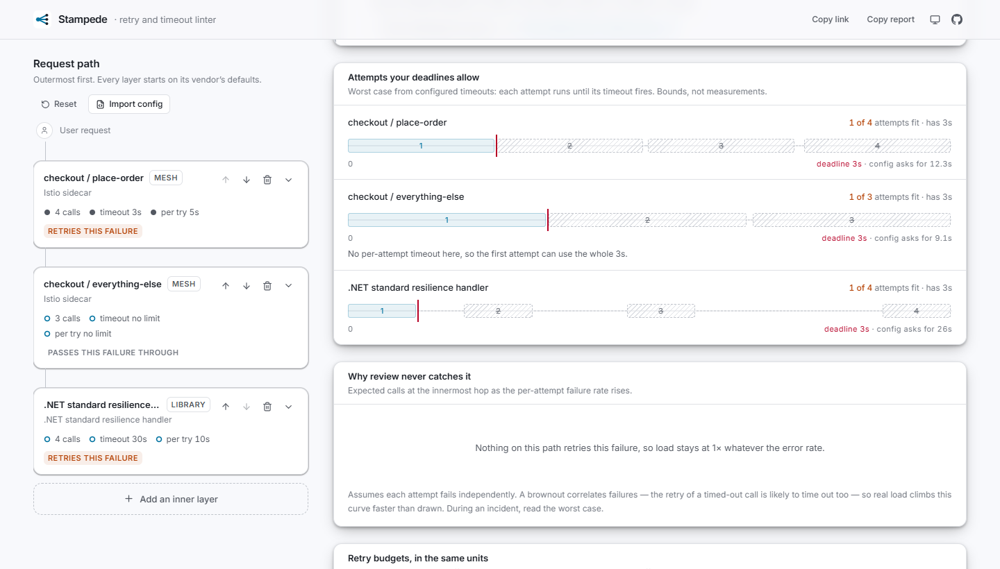

# Stampede

**The retries you never configured, multiplied out.**

Stampede is a retry and timeout linter for multi-hop request paths. You describe the layers a request passes through — an ingress, a service mesh, an SDK, a resilience library — and it shows how one failed request multiplies through them, which of your configured retries can never actually run, and where your deadlines let work continue after the caller has given up. Every finding carries a rule ID and the verbatim vendor documentation line it rests on.

**Live:** https://bassambeelal.github.io/stampede/


## Why this exists

Retry storms are a well-documented failure mode. The Google SRE book works the arithmetic by hand — three layers of four attempts is 4³ = 64 calls on the database for one user action — and AWS's Well-Architected framework names "retrying at multiple layers" as an anti-pattern. But the guidance is prose, and the tools stop short of it:

| Existing tool | What it does | What it misses |
| --- | --- | --- |
| `istioctl analyze`, Kiali | Validate Istio config: references, hosts, gateways, mTLS | No retry, timeout, per-try-timeout or budget checks at all |
| Backoff calculators | Tabulate the delays for one retry policy | One hop only — no chain, no deadlines, no inherited layers |
| Retry-storm simulators | Model many clients hammering one endpoint | Not the cross-hop product, and not your actual config |

The gap Stampede fills is the one engineers are structurally blind to: **the retries they never wrote.** Istio injects `attempts: 2` mesh-wide when a VirtualService says nothing about retries. ingress-nginx passes failed requests to the next pod up to three times. The AWS SDKs make three attempts; Boto3's legacy default makes five. urllib3 retries three times with zero delay. A team with no retry configuration anywhere can be running an 81× amplifier — and Stampede opens on exactly that path, with every number traced to a cited default.

## What it does

- **Layers you never set.** Pick the layers in your path. Each arrives pre-filled with its vendor's documented defaults, marked *inherited* and linked to the exact sentence that establishes it. Twelve layers ship today: Istio, Envoy, ingress-nginx, Linkerd, AWS SDKs, Boto3, gRPC, the .NET standard resilience handler, Polly, resilience4j, urllib3 and Spring Cloud LoadBalancer.
- **Per-failure amplification.** Layers disagree about what they retry — Istio's default policy retries a refused connection but not an HTTP 500 — so amplification is computed per failure class and drawn literally: one dot per call, retries in a warm colour.
- **Attempts your deadlines allow.** A deadline waterfall draws each hop's attempts and backoff against the time it actually has, and ghosts the attempts that can never start. The .NET standard handler's own defaults (four 10 s attempts inside a 30 s total) can only reach two.
- **Why review never catches it.** The expected-load curve shows a 81× path amplifying just 1.04× at a 1% error rate: indistinguishable from a safe config until the day it matters.
- **Budgets in the same units.** Envoy's "20%" caps retries in flight; Linkerd's "20%" caps retry rate. The translator puts every budget in both units using Little's law, and says when the conversion rests on your latency assumption.
- **Try the fix.** Where a remedy is mechanically determined and cited — a per-try timeout that lets every attempt fit, a jittered backoff — it can be applied in one click, with undo, and every number updates.
- **Import config.** Paste an Istio VirtualService or Envoy route (YAML or JSON). Retry and timeout keys become declared values; unrecognised keys under a retry policy are listed, never silently dropped.
- **Links and reports.** The whole path lives in the URL, encoded deterministically and schema-versioned: the same analysis always produces the same link, and a link from a different version is refused rather than misread. *Copy report* produces a paste-ready summary for a PR or postmortem.



## How it decides

A linter is only useful if it is trusted, so the model's limits are part of the product.

- **Every field is declared, inherited or unknown.** Unknown is a real state, not an empty input. Unknowns are resolved in the direction that cannot understate the problem: an unknown retry condition is assumed to retry; an unknown backoff is treated as zero (admitting the most attempts). An unknown try count can only be counted as one call, so the headline becomes "at least N×".
- **Numbers need citations.** A remedy that suggests a value must carry a citation — this is enforced by the `Remedy` type, not by convention. Where no vendor publishes a default, the finding states the constraint that was violated and says no default exists to cite.
- **Worst case, labelled as one.** Amplification assumes every attempt fails and nothing sheds load. Budgets, circuit breakers and outlier ejection act on live traffic, which configuration alone cannot show.
- **What it refuses to compute.** No composed percentiles — summing per-hop p99s describes no request that ever happened. No fan-out topologies, hedging or streams: a single linear path, or nothing.
- **Defaults drift.** Every citation records the doc version and the date it was read, and is shown on the finding.

## Rules

| ID | Finding | Severity |
| --- | --- | --- |
| RB001 | Some numbers rest on unknowns | needs context |
| RB101 | Per-try timeout is ignored (not below the overall timeout) | critical |
| RB102 | Retries that can never run inside the deadline | danger |
| RB103 | Keeps working after its caller gave up | caution |
| RB104 | No deadline anywhere on the path | danger |
| RB201 | Retries at more than one layer | danger |
| RB202 | Retry layers you never configured | caution |
| RB203 | More tries than the SRE per-request budget | caution |
| RB204 | Steady-state retries above the 10% budget | caution |
| RB205 | Nothing bounds retries during an outage | caution |
| RB206 | Retry budgets in incompatible units | caution |
| RB301 | Retries with no backoff | danger |
| RB302 | Backoff without jitter | caution |
| RB303 | Retrying work that is not safe to repeat | critical |

The in-app rule reference lists what each rule detects, when it is wrong, and its sources. All 60 sources are browsable from the app.

## Running it locally

Requires Node 20 or later.

```bash
npm install
npm run dev
```

```bash
npm test -- --run  # 111 unit tests over the math, rules, importer and permalinks
npm run lint
npm run build     # typechecks, then builds to dist/
```

## Project layout

```
src/
  domain/                 Pure TypeScript, no React — the product's logic
    model.ts              Hop, Chain, three-state FieldValue, Finding, Remedy
    registry/             Citations (verbatim, dated), layer defaults, failure classes
    math/                 Amplification, deadline composition, budget translation
    rules/                RB0xx–RB3xx, each a pure function of the analysis
    analyze.ts            Resolves unknowns, runs the math, runs the rules
    ingest.ts             Istio VirtualService and Envoy route import
    serialize.ts          Deterministic, schema-versioned permalinks
    report.ts             Paste-ready text report
  app/                    React views over the analysis
  ui/                     Design-system primitives
  styles/theme.css        OKLCH design tokens, light and dark
```

The domain layer has no UI dependencies and is where all the tests live. The views never compute anything themselves; they render an `Analysis`.

## Stack

React 19, TypeScript, Vite, Tailwind CSS 4, Vitest. Deployed to GitHub Pages by the workflow in `.github/workflows/deploy.yml`, which lints, tests and typechecks before publishing. Everything runs in the browser: nothing you enter or paste is sent anywhere.

## Out of scope

Validating the rest of a mesh configuration (that is `istioctl analyze`'s job), reading clusters or telemetry, modelling runtime enforcement such as circuit breakers and load shedding, fan-out and hedged requests, and CI integration — the honest end state for these rules is a check that runs against a repository's config, and the web page is the on-ramp to it.
